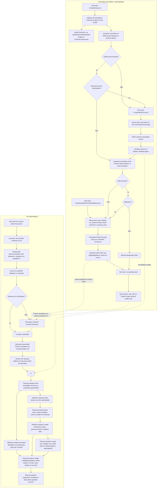

# Route Planner

Dit project helpt een pakketbezorger om afleverroutes te plannen. Je geeft een lijst met adressen op en kiest hoeveel ritten er nodig zijn of hoeveel chauffeurs beschikbaar zijn. Het programma controleert de adressen, verdeelt de leveringen over de chauffeurs en probeert het totale aantal gereden kilometers zo klein mogelijk te maken. Het resultaat bestaat uit kaarten en adressenlijsten in de juiste volgorde. Ook vergelijkt het programma de nieuwe routes met de bestaande routes, zodat je kunt zien of er kilometers worden bespaard.

Alle effectieve workflowstappen draaien in containers, inclusief de PowerShell-entrypoints. Scripts in `./scripts/` zijn dunne hostlaunchers: `setup.ps1` bouwt centraal alle benodigde containerimages en kan databereiding uitvoeren; `start.ps1` start de langlopende services zonder build of health-wait; de overige scripts voeren hun eenmalige workflowcontainer uit met vooraf gebouwde images. De host voert zelf geen workflow- of dataverwerkingslogica uit. De workflow plant pakketbezorging voor ongeveer 400 adressen en een lijst van ongeveer 10 chauffeurs. Per planning wordt óf het gewenste aantal ritten óf het aantal in te zetten chauffeurs opgegeven. Iedere geselecteerde chauffeur krijgt minstens één levering; het doel is de totale afstand over alle ritten te minimaliseren. Iedere chauffeur ontvangt een kaart van de toegewezen route op een OSM-achtergrondkaart en een adressenlijst in de juiste stopvolgorde. OSM-data en Valhalla-tegels worden in containers voorbereid of bijgewerkt buiten een normale planningsrun. Adresgeocodering is een aparte stap: OSM-routeringsdata zet adressen niet vanzelf om naar coördinaten.

## Invoerbestand

De planning ontvangt een puntkomma-gescheiden CSV met deze kolommen en volgorde:

```text
rit;naam;straat;nr.;postcode;gemeente;aantal;bellen;Opmerking;opmerking;klas
```

### Locatie en privacy

Plaats het inputbestand op dit pad, relatief vanaf de repository-root en buiten de projectmap en Git-repository:

```text
../jdc.routePlanner-private-data/input/ritten.csv
```

De map met private data mag geen onderdeel worden van deze repository of VS Code-workspace. `ritten.csv` bevat GDPR-gevoelige gegevens: kopieer het bestand niet naar de projectmap, testfixtures, logs of prompts. Geef de container die de invoer nodig heeft uitsluitend toegang via een expliciet geconfigureerde read-only mount; het pad binnen de container wordt door die mount bepaald. Bewaar ook rapporten, kaarten en adressenlijsten met persoonsgegevens buiten de repository.

## Entrypoints

De namen hieronder zijn de container-entrypoints. `CheckAddresses`, `UpdateGeocodeDatabase` en de adresreview zijn geïmplementeerd; de overige entrypoints zijn nog voorstellen. Alle runtime-services staan samen in `compose.yaml`. De setup-jobs FetchOsm en UpdateGeocodeDatabase staan apart in `compose.setup.yaml`. Scripts in `./scripts/` zijn dunne hostlaunchers; het effectieve werk gebeurt in containers. `./scripts/setup.ps1` valideert en bouwt de runtime-images, haalt Traefik op, bouwt beide setup-jobs en controleert daarna het OSM-extract en de Photon-database. Setup start geen langlopende services. `./scripts/start.ps1` start Photon, de reviewwebsite, API en Traefik uit de hoofdstack met bestaande images; het voert geen build, pull of health-wait uit. De overige workflowlaunchers gebruiken eveneens uitsluitend vooraf gebouwde images. `./scripts/checkAddresses.ps1` start de adrescontrole met Photon uit de hoofdstack. `./scripts/reviewAddresses.ps1` start Photon en de reviewservices uit diezelfde stack. `./scripts/updateGeocodeDatabase.ps1` voert de database-updatejob uit `compose.setup.yaml` uit en stopt/herstart Photon zo nodig in `compose.yaml`.

| EntryPoint | Moment | Verantwoordelijkheid in de container |
| --- | --- | --- |
| `FetchOsm` | Eenmalig of bij handmatig verversen | Downloadt het Geofabrik België-extract dat West-Vlaanderen omvat, controleert de MD5 en bewaart de brondata in beheerde opslag. |
| `BuildValhallaTiles` | Eenmalig of na wijzigingen aan data/configuratie | Bouwt of ververst Valhalla-tegels uit het OSM-extract. |
| `UpdateGeocodeDatabase` | Eenmalig en bij een databaseresfresh | Downloadt de officiële Photon Europa-dump, controleert de checksum en importeert alleen landcode `BE` naar een nieuwe lokale database. |
| `CheckAddresses` | Voor iedere planning | Valideert de exacte CSV-header en rijen en geocodeert via Photon op het interne Compose-netwerk; dedupliceert identieke aanvragen, herhaalt tijdelijke fouten begrensd en accepteert alleen unieke exacte adresmatches. Overige kandidaten en foutredenen komen in het rapport voor handmatige controle. |
| `ReviewAddresses` | Na iedere geocodingrun | Toont het bronadres en Photon-kandidaten in een lokale Angular-website. De .NET API bewaart bevestigde kandidaatkeuzes en coördinaten, of een onopgeloste beslissing met notitie. |
| `CreateRoutes` | Voor iedere planning | Valideert de gekozen ritten- of chauffeursaantallen, gebruikt Valhalla-kosten om leveringen toe te wijzen en te ordenen, en maakt de definitieve routegegevens. Iedere geselecteerde chauffeur krijgt werk; de totale afstand wordt geminimaliseerd. |
| `CreateDriverOutputs` | Na het maken van de routes | Maakt per chauffeur een OSM-kaart van de route en een adressenlijst in de exacte stopvolgorde. |
| `CreateComparisonReport` | Na het maken van de routes | Groepeert de bestaande routes op `rit`, berekent hun afstanden met Valhalla en maakt een vergelijkingsrapport met een OSM-kaart van de bestaande routes, een aparte kaart van alle berekende routes, afstand per route, totalen en het afstandsverschil. |

Photon draait samen met de reviewwebsite, API en Traefik in `compose.yaml`. Het is alleen via Traefik bereikbaar op `http://photon.localtest.me`; de containerpoort wordt niet rechtstreeks op de host gepubliceerd. Adressen gaan daardoor niet naar de publieke Photon-API. De updater gebruikt de Europese Photon 1.x JSON-dump als bron, maar geeft bij import `-country-codes BE` mee; alleen Belgische gegevens worden in de actieve Photon-index gezet. De Europese dump is ongeveer 13,4 GB gecomprimeerd en staat, samen met de index, in beheerde opslag buiten de repository. Voor de eerste import is extra schijfruimte nodig voor de download en stagingdatabase. De update bouwt eerst een nieuwe index en wisselt die pas na een geslaagde import; de vorige index blijft beschikbaar voor rollback.

`./scripts/fetchOsm.ps1` start de `fetch-osm`-service uit `compose.setup.yaml`. Dezelfde setup-stack bevat de Photon-database-updatejob onder het profiel `maintenance`. De OSM-container downloadt bij iedere handmatige start de nieuwste Geofabrik België-PBF (`https://download.geofabrik.de/europe/belgium-latest.osm.pbf`), verifieert de gepubliceerde MD5 en vervangt de bestaande extract pas na een geslaagde controle. Dit extract dekt heel België en daarmee West-Vlaanderen; het kan dus groter zijn dan het servicegebied. De PBF en `fetch-metadata.json` worden buiten de repository opgeslagen in `../jdc.routePlanner-private-data/osm`; `OSM_DATA_DIR` kan dit pad aanpassen. Downloaden van de brondata bouwt geen Valhalla-tegels. OSM-data © OpenStreetMap contributors, beschikbaar onder de ODbL; zie https://www.openstreetmap.org/copyright.

De Photon-updater logt de huidige fase naar de containeruitvoer. Tijdens downloaden toont `curl` een percentagebalk; tijdens het importeren toont `pv` elke vijf seconden een percentagebalk naar stderr, die Docker ook in de containerlogs verzamelt. Dit meet de invoerstroom, niet de interne indexeringsfase van OpenSearch. Bekijk de uitvoer van `./scripts/updateGeocodeDatabase.ps1` of `docker compose --profile maintenance -f compose.setup.yaml logs -f update-geocode-database` om voortgang te volgen.

De adrescontrole gebruikt de gedeelde PowerShell-base-image uit `containers/powershell/Dockerfile`: Alpine 3.24.3 met de officiële PowerShell 7.6.6 musl-x64-archive. De SHA256 wordt vóór installatie gecontroleerd. De base ondersteunt momenteel `amd64`. De Photon-container gebruikt ook Alpine 3.24.3, met Bash en Java 21; de Photon-entrypoint is `containers/photon/entrypoint.sh`.

Voer eerst `./scripts/setup.ps1` uit. Setup bouwt alle images uit `compose.yaml` en `compose.setup.yaml`, haalt de Traefik-image op en controleert daarna het OSM-extract en de Belgische Photon-index. Een ontbrekende dataset wordt automatisch opgebouwd; een bestaande dataset wordt alleen na bevestiging ververst. Setup start geen services. `./scripts/start.ps1` start Photon, de reviewwebsite, API en Traefik samen uit `compose.yaml` met `--no-build --pull never --detach`, zonder op healthchecks te wachten. De overige scripts bouwen of pullen geen images; voer setup opnieuw uit als een image is gewijzigd. `./scripts/checkAddresses.ps1` wacht wel op een gezonde Photon-service voordat de adrescontrole wordt uitgevoerd en stopt Photon na afloop als deze launcher hem zelf heeft gestart. De input wordt read-only gemount vanaf `../jdc.routePlanner-private-data/input`; het rapport wordt geschreven naar `../jdc.routePlanner-private-data/output/address-check.json`. Deze paden zijn relatief aan de repository-root en kunnen met `INPUT_DATA_DIR`, `OUTPUT_DATA_DIR` en `GEOCODER_DATA_DIR` worden aangepast. De exitcode van de adrescontrole is `0` wanneer alle adressen eenduidig zijn gevonden, `2` bij ongeldige/onopgeloste/ambigue records en `3` bij een geocoderfout. Configuratie- en inputfouten geven exitcode `1`.

Voer na `./scripts/checkAddresses.ps1` `./scripts/reviewAddresses.ps1` uit. De website is beschikbaar op `http://routing.localtest.me`, de API op `http://routing-api.localtest.me` en Photon op `http://photon.localtest.me`. Traefik gebruikt een statische configuratie zonder Docker-socket en publiceert alleen op `127.0.0.1:80`; `localtest.me` resolveert naar localhost. Poort 80 moet vrij zijn. De API krijgt de CSV en het geocodingrapport read-only, en schrijft uitsluitend naar de beheerde Docker-volume `jdc-route-planner-review-data`. De review staat daar als `/review/address-review.json`; eerdere reviews worden gearchiveerd wanneer het bronrapport of de CSV verandert. De CSV-rij is de enige reviewidentiteit; `rit` wordt niet als sleutel of reviewlabel gebruikt omdat routegroepen later kunnen wijzigen. De review bevat per CSV-rij de beslissing, gekozen kandidaat en bevestigde coördinaten. Records die onopgelost blijven blokkeren de volgende planningsstap. Latere plannercontainers moeten deze volume read-only mounten en alleen geaccepteerde records gebruiken.

De reviewwebsite gebruikt Angular 21 en Node 24. Open de repository in de `.devcontainer`; npm-installatie en Angular-ontwikkeling draaien daar, niet op de host. De API target .NET 11. De officiële .NET 11-images zijn voor deze runtime niet als Alpine-tags gepubliceerd; daarom gebruikt de API de gepinde `11.0.100-resolute-amd64` SDK- en `11.0.0-resolute-amd64` runtime-images.

De rijvolgorde binnen iedere bestaande `rit`-groep geldt als de stopvolgorde voor de baseline, omdat de CSV geen aparte stopvolgordekolom bevat. Beide plannen moeten met dezelfde Valhalla-versie, tegels, costing-profiel en regels voor start- en eindpunten worden doorgerekend. Zo is het verschil in totale kilometers vergelijkbaar.


