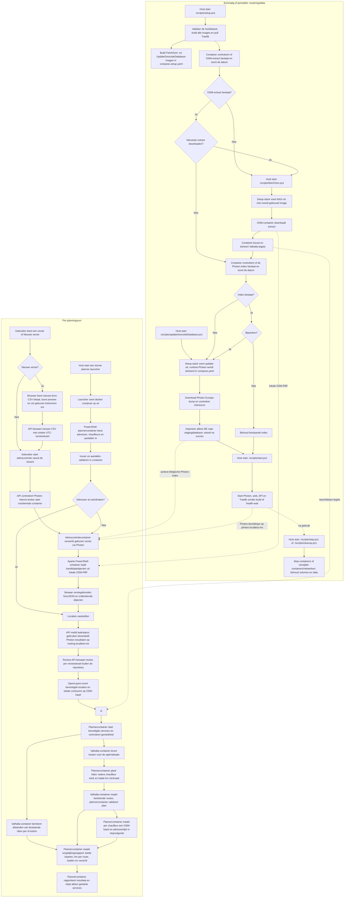

# Route Planner

Dit project helpt een pakketbezorger om afleverroutes te plannen. Je geeft een lijst met adressen op en kiest hoeveel ritten er nodig zijn of hoeveel chauffeurs beschikbaar zijn. De huidige routeberekening probeert de totale afstand te beperken, met een instelbaar maximaal verschil tussen de totale duren (rijtijd, levertijd en herlaadtijd). Kaarten, adreslijsten en de vergelijking met bestaande routes zijn nog toekomstige stappen.

Alle effectieve workflowstappen draaien in containers, inclusief de PowerShell-entrypoints. Scripts in `./scripts/` zijn dunne hostlaunchers: `setup.ps1` bouwt centraal alle benodigde containerimages en kan databereiding uitvoeren; `start.ps1` start de langlopende services zonder build of health-wait; `stop.ps1` stopt de containers uit beide Compose-stacks; `cleanup.ps1` verwijdert de containers en stacknetwerken zonder volumes of data te wissen; de overige scripts voeren hun eenmalige workflowcontainer uit met vooraf gebouwde images. De host voert zelf geen workflow- of dataverwerkingslogica uit. De beoogde workflow plant pakketbezorging voor ongeveer 400 adressen en een lijst van ongeveer 10 chauffeurs. Iedere geselecteerde chauffeur krijgt minstens één levering. De beoogde vervolguitvoer bestaat uit een kaart per chauffeur en een adressenlijst in de exacte stopvolgorde. OSM-data en Valhalla-tegels worden in containers voorbereid of bijgewerkt buiten een normale planningsrun. Adresgeocodering is een aparte stap: OSM-routeringsdata zet adressen niet vanzelf om naar coördinaten.

## Invoerbestand

De planning ontvangt een puntkomma-gescheiden CSV met deze kolommen en volgorde:

```text
rit;naam;straat;nr.;postcode;gemeente;aantal;bellen;Opmerking;opmerking;klas
```

### Locatie en privacy

Nieuwe invoerversies worden opgeslagen op dit pad, relatief vanaf de repository-root en buiten de projectmap en Git-repository:

```text
../jdc.routePlanner-private-data/input/ritten-<UTC-tijdstempel>.csv
```

De map met private data mag geen onderdeel worden van deze repository of VS Code-workspace. De CSV-bestanden bevatten GDPR-gevoelige gegevens: kopieer ze niet naar de projectmap, testfixtures, logs of prompts. De adrescontrole krijgt de invoermap read-only; de API krijgt alleen deze invoermap schrijfbaar om het gekozen bestand op te slaan. Bewaar ook rapporten, kaarten en adressenlijsten met persoonsgegevens buiten de repository.

Open `http://routing.localtest.me` na het starten van de services en kies **Nieuwe versie**. Selecteer een UTF-8-CSV met een kopregel (maximaal 10 MB). Het bronbestand wordt uitsluitend lokaal in de browser gelezen; selecteer de vier adreskolommen en bekijk de eerste tien leveringen. Alleen de omgezette CSV wordt via de lokale API verzonden. Kolommen met exact overeenkomende namen uit het schema blijven behouden, inclusief `Opmerking` en `opmerking`; ontbrekende overige velden blijven leeg en niet-herkende kolommen worden niet meegenomen. Invoer met ontbrekende adresvelden of foutieve rijen wordt niet opgeslagen. Iedere opslag maakt atomair een nieuw bestand met een unieke UTC-sleutel in het formaat `yyyyMMddTHHmmssfffffffZ`; eerdere bestanden blijven behouden. De API geeft de beschikbare sleutels via `GET /api/versions`, gebaseerd op de invoerbestanden. Het menu toont de tijd in de lokale tijdzone en ook de exacte UTC-sleutel. Een bestaand `ritten.csv` verschijnt als **Bestaande invoer** met sleutel `legacy`, zonder migratie of wijziging.

De opslag start de adrescontrole niet. Kies de versie en klik bij Geocoding op **Voer nu uit...**. De API controleert of Photon beschikbaar is en vraagt de interne broker om de voorbereide `check-addresses`-container te starten. Na een geslaagde adrescontrole start de broker automatisch de aparte `extract-osm-geometry`-container. De taak blijft lopen totdat ook de geometrie is verwerkt; daarna wordt de review automatisch geladen. Er kan maar één automatische adrescontrole tegelijk lopen. Exitcode `2` van de adrescontrole betekent dat een rapport met te beoordelen adressen is gemaakt en de geometrie alsnog wordt opgehaald; fouten in de geocoder of geometrie-extractie worden gemeld en kunnen opnieuw worden geprobeerd. De status blijft via de containerstatus en het taakvolume beschikbaar na een API- of brokerherstart.

De geometriecontainer leest de lokale PBF uit `OSM_DATA_DIR` read-only en haalt alle OSM-ID's uit het geocodingrapport met `osmium getid` en `osmium export`. Referenties worden uit hetzelfde bestand opgehaald; er is geen netwerktoegang. Ze bewaart `osm-geometry-<sleutel>.geojson` naast het rapport in `OUTPUT_DATA_DIR` (voor `legacy`: `osm-geometry.geojson`). De lokale API levert dit via `GET /api/versions/<sleutel>/osm-geometry` en weigert een bestand dat niet bij het actuele rapport hoort. In `metadata` staan ontbrekende objecten en kandidaten zonder bruikbare OSM-ID, inclusief hun CSV-recordnummers. Een OSM-node blijft een punt; niet iedere node heeft een gekoppelde gebouwcontour. Niet-multipolygonrelaties en onvolledige of ontbrekende geometrieën worden als ontbrekend gemeld. De Photon-dump en de lokale PBF kunnen van verschillende momenten zijn. Bij herextractie worden ook handmatig gevonden kandidaten uit de actuele review meegenomen. Bij ontbrekende geometrie of contouren biedt de kaart de knop **Laad de lokale geometrie**; na voltooiing wordt de kaartlaag automatisch ververst.

Voor een bestaande versie met een geocodingrapport kan de geometrie afzonderlijk worden gemaakt of na een PBF-update worden vernieuwd, zonder de review te vervangen:

```powershell
docker compose -f compose.yaml run --rm --no-deps -e CHECK_ADDRESSES_VERSION=20261117T1234561234567Z extract-osm-geometry
```

De adrescontrole kan ook handmatig met de sleutel uit het versiemenu worden gestart, bijvoorbeeld:

```powershell
./scripts/checkAddresses.ps1 -Version '20261117T1234561234567Z'
```

Zonder `-Version` controleert de launcher uitsluitend de oudere `legacy`-invoer. Kies daarna dezelfde versie in de website om haar geocodingreview te openen.

De API draait als niet-rootgebruiker en moet in de geconfigureerde `INPUT_DATA_DIR` bestanden kunnen aanmaken. De integratietests in `tests/InputCsv.Api.Tests.mjs` gebruiken Node.js 26.13.1 en een afzonderlijke API-container met uitsluitend tijdelijke, schrijfbare testmappen voor `/input`, `/source` en `/review`; koppel de echte privémappen nooit aan deze test. De testcontainer deelt het netwerk en dezelfde tijdelijke bind mounts voor `/input` en `/source`, en voert `node --test` uit. `tests/PhotonStub.mjs` biedt een lokale stub voor een geïsoleerde adrescontroletest.

De automatische start vereist toegang tot de Docker-daemon. Alleen `address-check-broker` krijgt `/var/run/docker.sock`; de API bereikt de broker via een apart intern netwerk, zonder gepubliceerde brokerpoort. De broker accepteert alleen geldige versies en controleert de Compose-project- en servicelabels voordat hij de vaste containers `jdc-route-planner-check-addresses-1` en `jdc-route-planner-extract-osm-geometry-1` start. Overschrijf daarom de Compose-projectnaam niet. De broker en de twee jobs delen uitsluitend het beheerde volume `address-check-jobs` voor de versiesleutel; beide jobs mounten dit read-only. `start.ps1` en `reviewAddresses.ps1` maken beide jobcontainers vooraf aan zonder deze te starten. Photon en de overige services blijven draaien na afloop.

**Beveiliging:** toegang tot de Docker-socket is in de praktijk gelijkwaardig aan beheerderstoegang tot de Docker-host, ook bij een niet-rootcontainer. Gebruik deze configuratie alleen op een vertrouwde lokale machine, scherm de lokale API af voor onbevoegden en publiceer de broker nooit extern. De socket moet lokaal op `/var/run/docker.sock` beschikbaar zijn. Docker Desktop gebruikt doorgaans socketgroep `0`; stel op Linux `DOCKER_SOCKET_GID` in op de numerieke groep die schrijfrechten op de socket heeft. Een externe Docker-daemon wordt niet ondersteund. De broker heeft geen directe toegang nodig tot de invoer- of rapportmappen.

De broker-integratietests in `tests/AddressCheckBroker.Tests.mjs` gebruiken een nep-Docker-socket en synthetische gegevens. Bouw hiervoor eerst de API-image en vervolgens `tests/Dockerfile.broker-tests`; die testimage gebruikt een Debian Node-build omdat Node in de niet-Alpine .NET-runtime moet kunnen draaien. Koppel nooit de echte Docker-socket aan deze test.

## Entrypoints

De namen hieronder zijn de container-entrypoints. `CheckAddresses`, `UpdateGeocodeDatabase`, de adresreview, matrixberekening en voorlopige route-indeling zijn geïmplementeerd; de overige entrypoints zijn nog voorstellen. Alle runtime-services staan samen in `compose.yaml`. De setup-jobs FetchOsm en UpdateGeocodeDatabase staan apart in `compose.setup.yaml`. Scripts in `./scripts/` zijn dunne hostlaunchers; het effectieve werk gebeurt in containers. `./scripts/setup.ps1` valideert en bouwt de runtime-images, haalt Traefik op, bouwt beide setup-jobs, controleert het OSM-extract en bouwt daarna Valhalla-tegels als die ontbreken. Bestaande tegels blijven behouden, tenzij `-Force` is opgegeven. Vervolgens controleert setup de Photon-database. Setup start geen langlopende services. `./scripts/start.ps1` start Photon, Valhalla, de matrix- en VROOM-worker, de reviewwebsite, API en Traefik uit de hoofdstack met bestaande images; het voert geen build, pull of health-wait uit. De overige workflowlaunchers gebruiken eveneens uitsluitend vooraf gebouwde images. `./scripts/checkAddresses.ps1` start de adrescontrole met Photon uit de hoofdstack. `./scripts/reviewAddresses.ps1` start Photon en de reviewservices uit diezelfde stack en start ook Valhalla voor matrixberekeningen. `./scripts/updateGeocodeDatabase.ps1` voert de database-updatejob uit `compose.setup.yaml` uit en stopt/herstart Photon zo nodig in `compose.yaml`.

`./scripts/stop.ps1` stopt alle containers uit `compose.yaml` en `compose.setup.yaml`, inclusief het maintenance-profiel. Het script valideert beide Compose-configuraties en controleert de Docker-daemon. Het gebruikt `docker compose stop`, niet `down`: containers blijven behouden en volumes, invoerbestanden, rapporten, OSM-data en Photon-data worden niet verwijderd. Gebruik `./scripts/stop.ps1 -WhatIf` om de actie eerst te simuleren; `-Confirm` vraagt bevestiging.

`./scripts/cleanup.ps1` verwijdert de containers en netwerken uit beide Compose-stacks, inclusief het maintenance-profiel en eventuele verweesde projectcontainers. Het gebruikt `docker compose down --remove-orphans`, zonder `--volumes`: Compose-volumes en bind-mounted invoer, uitvoer, OSM- en Photon-data blijven bestaan. Omdat containers hiermee worden verwijderd, vraagt het script standaard om bevestiging. Gebruik `./scripts/cleanup.ps1 -WhatIf` om de actie eerst te simuleren.

| EntryPoint | Moment | Verantwoordelijkheid in de container |
| --- | --- | --- |
| `FetchOsm` | Eenmalig of bij handmatig verversen | Downloadt het Geofabrik België-extract dat West-Vlaanderen omvat, controleert de MD5 en bewaart de brondata in beheerde opslag. |
| `BuildValhallaTiles` | Eenmalig of na wijzigingen aan data/configuratie | Bouwt of ververst Valhalla-tegels uit het OSM-extract. |
| `UpdateGeocodeDatabase` | Eenmalig en bij een databaseresfresh | Downloadt de officiële Photon Europa-dump, controleert de checksum en importeert alleen landcode `BE` naar een nieuwe lokale database. |
| `CheckAddresses` | Voor iedere planning | Wordt handmatig of via API en interne broker per versie gestart. Valideert de exacte CSV-header en rijen en geocodeert via Photon op het interne Compose-netwerk; dedupliceert identieke aanvragen, herhaalt tijdelijke fouten begrensd en accepteert alleen unieke exacte adresmatches. Overige kandidaten en foutredenen komen in het rapport voor handmatige controle. |
| `extract-osm-geometry` | Na iedere adrescontrole | De PowerShell-entrypoint haalt kandidaatobjecten en hun referenties uit de lokale PBF met Osmium en bewaart geometrieën en ontbrekende objecten als versiegebonden GeoJSON. De container heeft geen netwerktoegang. |
| `ReviewAddresses` | Na iedere geocodingrun | Toont het bronadres en Photon-kandidaten in een lokale Angular-website. De .NET API bewaart bevestigde kandidaatkeuzes en coördinaten, of een onopgeloste beslissing met notitie. |
| `matrix-worker` (`--matrix-worker`) | Na een volledig bevestigde review | Berekent met Valhalla een afstands- en tijdmatrix en schrijft een VROOM-matrixfragment naar de externe uitvoermap. |
| `vroom-worker` (`server.mjs`) | Na een actuele matrix | Verdeelt en ordent alle leveringen met VROOM en een balansheuristiek; bewaart voorlopige route-indeling en status buiten de repository. |
| `CreateDriverOutputs` | Na het maken van de routes | Maakt per chauffeur een OSM-kaart van de route en een adressenlijst in de exacte stopvolgorde. |
| `CreateComparisonReport` | Na het maken van de routes | Groepeert de bestaande routes op `rit`, berekent hun afstanden met Valhalla en maakt een vergelijkingsrapport met een OSM-kaart van de bestaande routes, een aparte kaart van alle berekende routes, afstand per route, totalen en het afstandsverschil. |

Photon draait samen met de reviewwebsite, API en Traefik in `compose.yaml`. Het is alleen via Traefik bereikbaar op `http://photon.localtest.me`; de containerpoort wordt niet rechtstreeks op de host gepubliceerd. Adressen gaan daardoor niet naar de publieke Photon-API. De updater gebruikt de Europese Photon 1.x JSON-dump als bron, maar geeft bij import `-country-codes BE` mee; alleen Belgische gegevens worden in de actieve Photon-index gezet. De Europese dump is ongeveer 13,4 GB gecomprimeerd en staat, samen met de index, in beheerde opslag buiten de repository. Voor de eerste import is extra schijfruimte nodig voor de download en stagingdatabase. De update bouwt eerst een nieuwe index en wisselt die pas na een geslaagde import; de vorige index blijft beschikbaar voor rollback.

`./scripts/fetchOsm.ps1` start de `fetch-osm`-service uit `compose.setup.yaml`. Dezelfde setup-stack bevat de Photon-database-updatejob onder het profiel `maintenance`. De OSM-container downloadt bij iedere handmatige start de nieuwste Geofabrik België-PBF (`https://download.geofabrik.de/europe/belgium-latest.osm.pbf`), verifieert de gepubliceerde MD5 en vervangt de bestaande extract pas na een geslaagde controle. Dit extract dekt heel België en daarmee West-Vlaanderen; het kan dus groter zijn dan het servicegebied. De PBF en `fetch-metadata.json` worden buiten de repository opgeslagen in `../jdc.routePlanner-private-data/osm`; `OSM_DATA_DIR` kan dit pad aanpassen. Downloaden van de brondata bouwt geen Valhalla-tegels. OSM-data © OpenStreetMap contributors, beschikbaar onder de ODbL; zie https://www.openstreetmap.org/copyright.

De Photon-updater logt de huidige fase naar de containeruitvoer. Tijdens downloaden toont `curl` een percentagebalk; tijdens het importeren toont `pv` elke vijf seconden een percentagebalk naar stderr, die Docker ook in de containerlogs verzamelt. Dit meet de invoerstroom, niet de interne indexeringsfase van OpenSearch. Bekijk de uitvoer van `./scripts/updateGeocodeDatabase.ps1` of `docker compose --profile maintenance -f compose.setup.yaml logs -f update-geocode-database` om voortgang te volgen.

De adrescontrole gebruikt de gedeelde PowerShell-base-image uit `containers/powershell/Dockerfile`: Alpine 3.24.4 met de officiële PowerShell 7.7.0 musl-x64-archive. De SHA256 wordt vóór installatie gecontroleerd. De base ondersteunt momenteel `amd64`. De Photon-container gebruikt Alpine 3.24.3, met Bash en Java 21; de Photon-entrypoint is `containers/photon/entrypoint.sh`.

Voer eerst `./scripts/setup.ps1` uit. Setup bouwt alle images uit `compose.yaml` en `compose.setup.yaml`, haalt de Traefik-image op en controleert daarna het OSM-extract en de Belgische Photon-index. Ontbrekende OSM- en Photondata worden opgehaald en ontbrekende Valhalla-tegels worden gebouwd; bestaande data blijft zonder prompt behouden. Gebruik `./scripts/setup.ps1 --force` (of PowerShell-native `./scripts/setup.ps1 -Force`) om bestaande OSM- en Photondata te verversen en Valhalla-tegels opnieuw te bouwen. Setup start geen services. `./scripts/start.ps1` start de services uit `compose.yaml` met `--no-build --pull never --detach`, zonder op healthchecks te wachten. De overige scripts bouwen of pullen geen images; voer setup opnieuw uit als een image is gewijzigd. `./scripts/checkAddresses.ps1 -Version <sleutel>` wacht wel op een gezonde Photon-service voordat de adrescontrole wordt uitgevoerd en stopt Photon na afloop als deze launcher hem zelf heeft gestart. De input wordt read-only gemount vanaf `../jdc.routePlanner-private-data/input`; het rapport wordt geschreven naar `../jdc.routePlanner-private-data/output/address-check-<sleutel>.json`. De oudere `legacy`-versie gebruikt `ritten.csv` en `address-check.json`. Deze paden zijn relatief aan de repository-root en kunnen met `INPUT_DATA_DIR`, `OUTPUT_DATA_DIR` en `GEOCODER_DATA_DIR` worden aangepast. De exitcode van de adrescontrole is `0` wanneer alle adressen eenduidig zijn gevonden, `2` bij ongeldige/onopgeloste/ambigue records en `3` bij een geocoderfout. Configuratie- en inputfouten geven exitcode `1`.

Voer na `./scripts/checkAddresses.ps1` `./scripts/reviewAddresses.ps1` uit. De website is beschikbaar op `http://routing.localtest.me`, de API op `http://routing-api.localtest.me` en Photon op `http://photon.localtest.me`. Traefik gebruikt een statische configuratie zonder Docker-socket en publiceert alleen op `127.0.0.1:80`; `localtest.me` resolveert naar localhost. Poort 80 moet vrij zijn. De API leest het geocodingrapport read-only, schrijft de invoer in de apart gemounte invoermap en bewaart de review in de beheerde Docker-volume `jdc-route-planner-review-data`. Per versie kunnen extra instellingen worden bewaard in `settings-<sleutel>.json` in `OUTPUT_DATA_DIR` (voor `legacy`: `settings.json`) met de vorm `{"StartLocation": {...}, "Settings": {"sleutel": "waarde"}}`; oudere platte bestanden worden bij het lezen als `Settings` geïnterpreteerd. De startlocatie wordt eerst via de lokale Photon gezocht (`POST /api/versions/<sleutel>/start-location/search` met `{"query":"..."}`) en daarna bewaard met `PUT|GET|DELETE /api/versions/<sleutel>/start-location`. De API is daarom schrijfbaar op die map. `GET /api/versions/<sleutel>/settings` geeft het hele document; `GET|PUT|DELETE /api/versions/<sleutel>/settings/<key>` beheert de tekstwaarden (PUT-body: `{"value":"..."}`; sleutel `[A-Za-z0-9_.-]{1,64}`, waarde maximaal 1000 tekens). Per versie staat de review daar als `/review/address-review-<sleutel>.json`; voor `legacy` blijft dit `/review/address-review.json`. Eerdere reviews worden gearchiveerd wanneer het bijbehorende bronrapport of de CSV verandert. Nieuwe geocodingrapporten bevatten een SHA-256 van de invoer, zodat review van een verouderd rapport wordt geweigerd. Oudere rapporten zonder hash worden gecontroleerd op basis van bestandswijzigingstijden. De CSV-rij is de enige reviewidentiteit binnen een versie; `rit` wordt niet als sleutel of reviewlabel gebruikt omdat routegroepen later kunnen wijzigen. De review bevat per CSV-rij de beslissing, gekozen kandidaat en bevestigde coördinaten. Records die onopgelost blijven blokkeren de volgende planningsstap. Latere plannercontainers moeten deze volume read-only mounten en alleen geaccepteerde records gebruiken.

In de instellingen van Routeplanning wordt **Aantal Chauffeurs** per versie als positieve gehele tekstwaarde onder de sleutel `nmbDrivers` via de instellingen-API opgeslagen. Zonder opgeslagen waarde blijft het veld leeg. **LeverTijd (sec)** wordt als positief geheel aantal seconden (maximaal 2147483647) onder de sleutel `serviceSeconds` opgeslagen. Als die sleutel ontbreekt, gebruikt de berekening standaard 60 seconden; nul en ongeldige waarden worden geweigerd. **Capaciteit** (`Capacity`) is het positieve gehele maximum aantal pakketten per rit en staat standaard op 60. **Laadtijd depot (sec)** (`reloadSeconds`) is een niet-negatief geheel aantal seconden en staat standaard op 10. **Maximaal tijdsverschil (min)** (`maxDifferenceMinutes`) is een niet-negatief geheel aantal minuten en staat standaard op 30; nul vereist gelijke totale duren. Deze waarden mogen maximaal 2147483647 zijn.

Na een volledig afgeronde review toont **Routeplanning** met OpenLayers alle bevestigde leverlocaties en beschikbare lokale objectcontouren op een OpenStreetMap-kaart. Leveradressen worden standaard afzonderlijk weergegeven; via **Kaartopties** kan clustering worden ingeschakeld. Samenvallende locaties blijven samen aanklikbaar; ontbrekende coördinaten en contouren worden gemeld. De kaart toont nog geen berekende routes. **Bereken Matrix** start via `POST /api/versions/<sleutel>/matrix-calculation` een asynchrone berekening; `GET` op hetzelfde pad geeft de status. **Bereken route** gebruikt `POST /api/versions/<sleutel>/route-calculation`; `GET` op hetzelfde pad geeft de status en `GET /api/versions/<sleutel>/routes` geeft uitsluitend een actueel resultaat. Beide knoppen zijn uitgeschakeld zolang de bijbehorende berekening loopt of de status onbekend is. De website toont per chauffeur totale duur, rijtijd, levertijd, afstand en CSV-recordnummers in stopvolgorde. De achtergrondtegels komen momenteel rechtstreeks van de publieke OpenStreetMap-tegelserver, niet uit de lokale PBF; de browser deelt daarbij zijn IP-adres en het bekeken kaartgebied met die server. De adressen en coördinaten zelf worden niet als adreszoekopdracht verzonden. Voor volledig lokale kaartweergave is een eigen tegelservice nodig.

De aparte `matrix-worker` gebruikt geen Docker-socket. Hij controleert de bereikbaarheid van Valhalla en verwerkt maximaal 20 bronnen en 20 doelen per matrixaanvraag. Valhalla 3.9.3 gebruikt het profiel `auto` met `shortest: true`; de configuratie moet ten minste 400 matrixparen per aanvraag toestaan en alle punten bestrijken. Onbereikbare verbindingen, ongeldige antwoorden, servicefouten en een gewijzigde review tijdens de berekening leiden tot een foutstatus, niet tot een gedeeltelijke matrix. De worker schrijft atomair `matrix-<sleutel>.json` en `matrix-status-<sleutel>.json` in `OUTPUT_DATA_DIR` (voor `legacy`: `matrix.json` en `matrix-status.json`). De map moet ook voor de niet-rootgebruiker van de worker schrijfbaar zijn. De bestanden bevatten gevoelige locatiegegevens en blijven buiten de repository. Een onderbroken berekening wordt na een workerherstart als mislukt gemeld. Een eerder resultaat kan bij een mislukte herberekening blijven bestaan: gebruik het alleen wanneer de API-status `completed` is. Na wijziging van review of startlocatie wordt die status `stale` en is een nieuwe berekening nodig.

Het matrixresultaat is een VROOM-fragment: `matrices.car.durations` bevat gehele seconden, `distances` gehele meters en `costs` dezelfde afstanden. `metadata.locations` koppelt elke matrixindex aan een `csvRecordNumber` en coördinaten; iedere CSV-rij heeft een eigen index, ook bij identieke coördinaten. Een ingestelde startlocatie staat eerst met `csvRecordNumber: null`; zonder startlocatie bevat de matrix alleen leveringen. De metadata bevat ook de review- en locatiefingerprints.

De aparte `vroom-worker` gebruikt de officiële, gepinde `ghcr.io/vroom-project/vroom-docker:v1.15.0`-image met Node en VROOM; een Alpine-variant met dezelfde VROOM-runtime en native afhankelijkheden is niet geverifieerd. Hij heeft geen Docker-socket of gepubliceerde hostpoort en communiceert met de API via het interne `route-planning`-netwerk. Voor de routegeometrie bereikt hij ook de lokale Valhalla-service via het standaardnetwerk. De API vereist een actuele matrix, een ingestelde startlocatie en een opgeslagen positief `nmbDrivers` dat niet groter is dan het aantal leveringen. De kolom `aantal` moet voor iedere levering een positief geheel aantal pakketten bevatten dat niet groter is dan `Capacity`; lege, ongeldige en te grote aantallen leiden tot een fout met het CSV-recordnummer. Leveringen worden niet gesplitst.

VROOM plant capaciteitsbegrensde retourritten vanaf het depot; resterende leveringen worden in volgende rondes gepland. De ritten worden daarna over de chauffeurs verdeeld. Tussen twee ritten van dezelfde chauffeur vindt een terugkeer naar het depot plaats; de rijafstand en rijtijd van die terugkeer en de ingestelde herlaadtijd worden meegerekend. Voor vertrek van de eerste rit en na de laatste rit wordt geen herlaadtijd toegevoegd. Per bezoek aan een leverlocatie wordt de ingestelde levertijd gerekend. Direct opeenvolgende leveringen met exact dezelfde bevestigde coördinaten vormen één bezoek; na vertrek en terugkeer telt een nieuw bezoek, ook na een depotbezoek. Een levering op de startlocatie telt ook als bezoek, maar het vertrek en de terugkeer zonder levering niet. VROOM krijgt de levertijd als `setup` en gebruikt voor samenvallende punten één locatie-index, na controle dat hun matrixkosten overeenkomen; de oorspronkelijke CSV-records en matrixindexen blijven afzonderlijk in de uitvoer.

Een begrensde lokale zoekheuristiek probeert vervolgens het ingestelde maximale verschil tussen de langste en kortste totale duur per chauffeur (rijtijd, levertijd en herlaadtijd over alle ritten) te bereiken en daarna binnen die grens de totale afstand te verkleinen, zonder de capaciteit te overschrijden. Bij gelijke afstand krijgt een kleiner duurverschil voorrang. Dit is geen bewijs van een globaal optimale oplossing. Iedere chauffeur krijgt minstens één levering en iedere levering precies één keer. Als de heuristiek geen volledige verdeling binnen het ingestelde tijdsverschil vindt, wordt een fout gemeld, geen gedeeltelijk resultaat.

De worker schrijft atomair `routes-<sleutel>.json` en `routes-status-<sleutel>.json` in `OUTPUT_DATA_DIR` (`routes.json` en `routes-status.json` voor `legacy`). De uitvoer bevat per chauffeur `trips` met pakketlading, geordende stops en afstand en rijtijd per rit, en daarnaast de totale rijtijd, levertijd, herlaadtijd, duur en afstand. De vlakke `stops`-lijst blijft beschikbaar; iedere stop bevat CSV-recordnummer, matrixindex, pakketaantal en toegerekende levertijd. Metadata bevat onder meer de hashes van de invoer en matrix en de gebruikte instellingen. De API controleert of invoer, matrix, review, startlocatie en instellingen nog overeenkomen; na wijzigingen is een nieuwe berekening nodig. Routebestanden met de vorige optimalisatiemethode worden als verouderd beschouwd. Een mislukte of onderbroken berekening kan een ouder bestand laten staan: gebruik uitsluitend resultaten waarvoor de API-status `completed` is.

De kaart toont actuele berekende routes per chauffeur in een eigen kleur, inclusief de tussentijdse depotritten. Via `GET /api/versions/<sleutel>/route-geometry` vraagt de worker de weggeometrie voor elke opeenvolgende verbinding op bij de lokale Valhalla-service met hetzelfde `auto`-profiel en `shortest`-instelling als de matrix. De kaart wacht op alle verbindingen en toont bij een fout geen gedeeltelijke routes; de geometrie wordt op verzoek opnieuw opgehaald en niet opgeslagen. Vanaf de zeventiende chauffeur worden de 16 kleuren herhaald. De voorlopige indeling bevat nog geen turn-by-turngegevens, kaart per chauffeur, adreslijsten of vergelijking met de menselijke baseline en is geen volledig afleverplan. De synthetische `tests/VroomWorker.Tests.mjs` voert VROOM in de gebouwde workerimage uit zonder privégegevens of Docker-socket; `tests/RouteGeometry.Tests.mjs` gebruikt een synthetische Valhalla-stub.

Na het ophalen van een route stopt de automatische verversing van de routestatus en het resultaat. Een nieuwe routeberekening start die opnieuw. Wijzigingen aan instellingen of startlocatie en het starten van een matrixberekening in deze GUI maken het getoonde resultaat direct verouderd; wijzigingen elders worden pas na herladen of een nieuwe berekening opgemerkt.

Na een wijziging van Valhalla-tegels of -configuratie moet de matrix opnieuw worden berekend; de huidige statuscontrole herkent zulke wijzigingen nog niet automatisch. De geïsoleerde workertest `tests/MatrixWorker.Tests.mjs` gebruikt een synthetische Valhalla- en API-stub. Bouw de API-image en vervolgens `tests/Dockerfile.broker-tests`; voer de test met Node in die testimage uit, zonder privémappen of Docker-socket te koppelen.

De geometriecontainer gebruikt Ubuntu 24.04 met PowerShell 7.7.0 (glibc-build, checksum-gecontroleerd) en `osmium-tool`, omdat de gewenste Osmium-binary niet als `osmium-tool`-pakket in de bestaande Alpine 3.24-pakketindex beschikbaar is. De aparte PowerShell-entrypoint (`containers/extract-osm-geometry/entrypoint.ps1`) verwerkt alleen de geselecteerde kandidaatobjecten; elke Osmium-aanroep met argumenten, uitvoer en exitcode wordt naar het containerlog geschreven. De PBF wordt gelezen maar niet aangepast. De Osmium-extractie kan bij veel of complexe relaties tijdelijk ruimte in `/tmp` nodig hebben. De synthetische Pester-test `tests/ExtractOsmGeometry.Tests.ps1` gebruikt een zelfgemaakte PBF en vereist geen privégegevens; voer hem uit in de geometrie-image met Pester 5 (`docker run --rm --entrypoint pwsh -v <tests>:/tests:ro -v <Pester-map>:/modules/Pester:ro <image> -Command "Import-Module /modules/Pester/Pester.psd1; Invoke-Pester /tests/ExtractOsmGeometry.Tests.ps1"`).

De reviewwebsite gebruikt Angular 21 en Node.js 26.13.1. Open de repository in de `.devcontainer`; npm-installatie en Angular-ontwikkeling draaien daar, niet op de host. De API target .NET 11. De officiële .NET 11-images zijn voor deze runtime niet als Alpine-tags gepubliceerd; daarom gebruikt de API de gepinde `11.0.100-resolute-amd64` SDK- en `11.0.0-resolute-amd64` runtime-images.

De rijvolgorde binnen iedere bestaande `rit`-groep geldt als de stopvolgorde voor de baseline, omdat de CSV geen aparte stopvolgordekolom bevat. Beide plannen moeten met dezelfde Valhalla-versie, tegels, costing-profiel en regels voor start- en eindpunten worden doorgerekend. Zo is het verschil in totale kilometers vergelijkbaar.


