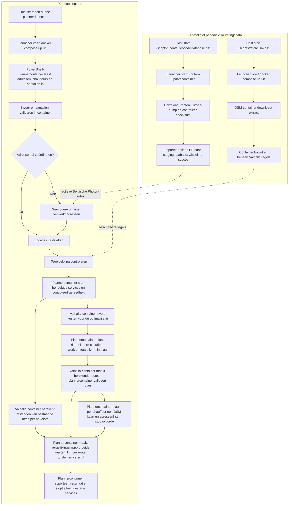

# Route Planner

Dit project helpt een pakketbezorger om afleverroutes te plannen. Je geeft een lijst met adressen op en kiest hoeveel ritten er nodig zijn of hoeveel chauffeurs beschikbaar zijn. Het programma controleert de adressen, verdeelt de leveringen over de chauffeurs en probeert het totale aantal gereden kilometers zo klein mogelijk te maken. Het resultaat bestaat uit kaarten en adressenlijsten in de juiste volgorde. Ook vergelijkt het programma de nieuwe routes met de bestaande routes, zodat je kunt zien of er kilometers worden bespaard.

Alle effectieve workflowstappen draaien in containers, inclusief de PowerShell-entrypoints. Kleine scripts in `./scripts/` draaien op de host alleen als launchers die met `docker compose up` de juiste container starten; bijvoorbeeld `./scripts/fetchOsm.ps1` start de OSM-voorbereidingscontainer. De host voert zelf geen workflow- of dataverwerkingslogica uit. De workflow plant pakketbezorging voor ongeveer 400 adressen en een lijst van ongeveer 10 chauffeurs. Per planning wordt óf het gewenste aantal ritten óf het aantal in te zetten chauffeurs opgegeven. Iedere geselecteerde chauffeur krijgt minstens één levering; het doel is de totale afstand over alle ritten te minimaliseren. Iedere chauffeur ontvangt een kaart van de toegewezen route op een OSM-achtergrondkaart en een adressenlijst in de juiste stopvolgorde. OSM-data en Valhalla-tegels worden in containers voorbereid of bijgewerkt buiten een normale planningsrun. Adresgeocodering is een aparte stap: OSM-routeringsdata zet adressen niet vanzelf om naar coördinaten.

## Invoerbestand

De planning ontvangt een puntkomma-gescheiden CSV met deze kolommen en volgorde:

```text
rit;naam;straat;nr.;postcode;gemeente;aantal;bellen;Opmerking;opmerking;klas
```

### Locatie en privacy

Plaats het inputbestand op dit pad, relatief vanaf de repository-root en buiten de projectmap en Git-repository:

```text
../jdc.routePlanner-private-data/input/ritten.csv
```

De map met private data mag geen onderdeel worden van deze repository of VS Code-workspace. `ritten.csv` bevat GDPR-gevoelige gegevens: kopieer het bestand niet naar de projectmap, testfixtures, logs of prompts. Geef de container die de invoer nodig heeft uitsluitend toegang via een expliciet geconfigureerde read-only mount; het pad binnen de container wordt door die mount bepaald. Bewaar ook rapporten, kaarten en adressenlijsten met persoonsgegevens buiten de repository.

## Entrypoints

De namen hieronder zijn de container-entrypoints. `CheckAddresses` en `UpdateGeocodeDatabase` zijn geïmplementeerd; de overige entrypoints zijn nog voorstellen. Scripts in `./scripts/` zijn host-side launchers; het effectieve werk gebeurt in de container. `./scripts/checkAddresses.ps1` start de adrescontrole met de lokale Photon-service. `./scripts/updateGeocodeDatabase.ps1` start de aparte database-updatecontainer.

| EntryPoint | Moment | Verantwoordelijkheid in de container |
| --- | --- | --- |
| `FetchOsm` | Eenmalig of bij verversen | Downloadt het gekozen OSM-extract naar beheerde opslag. |
| `BuildValhallaTiles` | Eenmalig of na wijzigingen aan data/configuratie | Bouwt of ververst Valhalla-tegels uit het OSM-extract. |
| `UpdateGeocodeDatabase` | Eenmalig en bij een databaseresfresh | Downloadt de officiële Photon Europa-dump, controleert de checksum en importeert alleen landcode `BE` naar een nieuwe lokale database. |
| `CheckAddresses` | Voor iedere planning | Valideert de exacte CSV-header en rijen en geocodeert adressen via Photon op het interne Compose-netwerk; rapporteert ongeldige, onopgeloste en ambigue adressen. |
| `CreateRoutes` | Voor iedere planning | Valideert de gekozen ritten- of chauffeursaantallen, gebruikt Valhalla-kosten om leveringen toe te wijzen en te ordenen, en maakt de definitieve routegegevens. Iedere geselecteerde chauffeur krijgt werk; de totale afstand wordt geminimaliseerd. |
| `CreateDriverOutputs` | Na het maken van de routes | Maakt per chauffeur een OSM-kaart van de route en een adressenlijst in de exacte stopvolgorde. |
| `CreateComparisonReport` | Na het maken van de routes | Groepeert de bestaande routes op `rit`, berekent hun afstanden met Valhalla en maakt een vergelijkingsrapport met een OSM-kaart van de bestaande routes, een aparte kaart van alle berekende routes, afstand per route, totalen en het afstandsverschil. |

Photon draait lokaal als Compose-service en wordt niet op een hostpoort gepubliceerd. Adressen worden daardoor niet naar de publieke Photon-API gestuurd. De updater gebruikt de Europese Photon 1.x JSON-dump als bron, maar geeft bij import `-country-codes BE` mee; alleen Belgische gegevens worden in de actieve Photon-index gezet. De Europese dump is ongeveer 13,4 GB gecomprimeerd en staat, samen met de index, in beheerde opslag buiten de repository. Voor de eerste import is extra schijfruimte nodig voor de download en stagingdatabase. De update bouwt eerst een nieuwe index en wisselt die pas na een geslaagde import; de vorige index blijft beschikbaar voor rollback.

De Photon-updater logt de huidige fase naar de containeruitvoer. Tijdens downloaden toont `curl` een percentagebalk; tijdens het importeren toont `pv` elke vijf seconden een percentagebalk naar stderr, die Docker ook in de containerlogs verzamelt. Dit meet de invoerstroom, niet de interne indexeringsfase van OpenSearch. Bekijk de uitvoer van `./scripts/updateGeocodeDatabase.ps1` of `docker compose logs -f update-geocode-database` om voortgang te volgen.

De adrescontrole gebruikt de gedeelde PowerShell-base-image uit `containers/powershell/Dockerfile`: Alpine 3.24.3 met de officiële PowerShell 7.6.6 musl-x64-archive. De SHA256 wordt vóór installatie gecontroleerd. De base ondersteunt momenteel `amd64`. De Photon-container gebruikt ook Alpine 3.24.3, met Bash en Java 21; de Photon-entrypoint is `containers/photon/entrypoint.sh`.

Voer eerst `./scripts/updateGeocodeDatabase.ps1` uit om de Belgische Photon-index op te bouwen. Daarna start `./scripts/checkAddresses.ps1` Photon automatisch wanneer die nog niet draait. De input wordt read-only gemount vanaf `../jdc.routePlanner-private-data/input`; het rapport wordt geschreven naar `../jdc.routePlanner-private-data/output/address-check.json`. Deze paden zijn relatief aan de repository-root en kunnen met `INPUT_DATA_DIR`, `OUTPUT_DATA_DIR` en `GEOCODER_DATA_DIR` worden aangepast. De exitcode van de adrescontrole is `0` wanneer alle adressen eenduidig zijn gevonden, `2` bij ongeldige/onopgeloste/ambigue records en `3` bij een geocoderfout. Configuratie- en inputfouten geven exitcode `1`.

De rijvolgorde binnen iedere bestaande `rit`-groep geldt als de stopvolgorde voor de baseline, omdat de CSV geen aparte stopvolgordekolom bevat. Beide plannen moeten met dezelfde Valhalla-versie, tegels, costing-profiel en regels voor start- en eindpunten worden doorgerekend. Zo is het verschil in totale kilometers vergelijkbaar.


